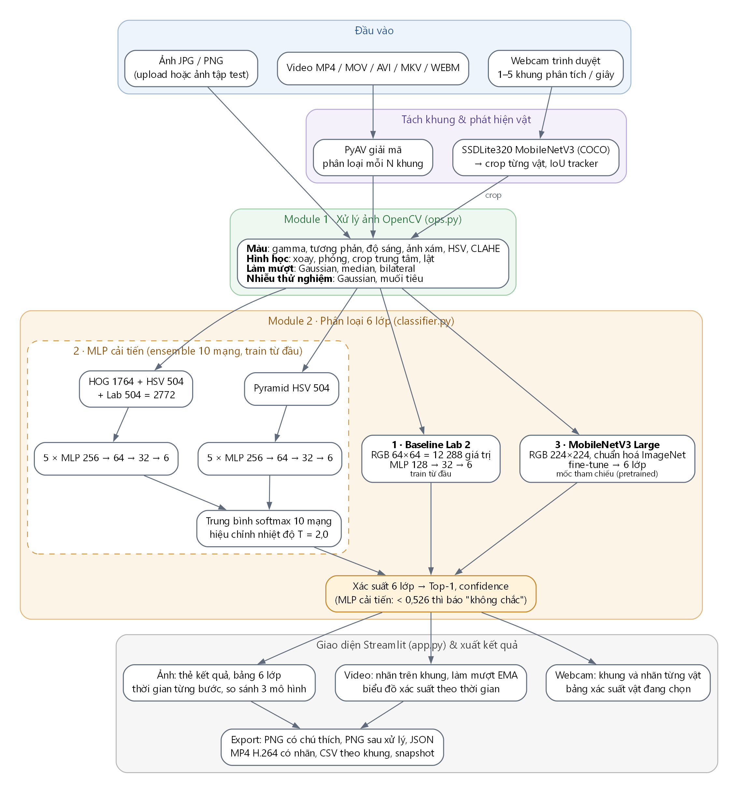

# Kiến trúc và giao diện

## Sơ đồ kiến trúc



Ba nguồn đầu vào đều đi qua cùng một Module 1 (OpenCV), rồi tới mô hình được chọn ở Module 2:

- **Ảnh:** đưa thẳng vào Module 1.
- **Video:** PyAV giải mã, Module 1 xử lý mọi khung, mô hình phân loại mỗi N khung, xác suất được làm mượt bằng EMA.
- **Webcam:** SSDLite320 MobileNetV3 (COCO, pretrained) tìm vật, mỗi vùng crop qua Module 1 rồi được phân loại. Bộ phát hiện chỉ định vị vật, không ảnh hưởng đến cách huấn luyện ba mô hình phân loại.

Cả ba mô hình đều trả về xác suất 6 lớp. Riêng MLP cải tiến hiệu chỉnh xác suất bằng temperature scaling (T = 2,0) và báo "không chắc" khi xác suất cao nhất dưới 0,526.

Nguồn sơ đồ: [`figures/architecture.dot`](figures/architecture.dot). Sau khi sửa, vẽ lại bằng Graphviz:

```powershell
dot -Tsvg docs/figures/architecture.dot -o docs/figures/architecture.svg
dot -Tpng -Gdpi=200 docs/figures/architecture.dot -o docs/figures/architecture.png
```

## Ảnh giao diện

Mọi ảnh được chụp từ app chạy cục bộ. Tab Ảnh dùng ảnh test cố định `plastic73.jpg` (nhãn thật: Nhựa).

| # | Ảnh | Chức năng | Yêu cầu |
| --- | --- | --- | --- |
| 1 | [Trang chủ](screenshots/01-trang-chu.png) | Chọn nguồn đầu vào (Ảnh, Video, Webcam), upload JPG/PNG, ảnh mẫu theo lớp từ tập test | Giao diện, đầu vào ảnh |
| 2 | [Kết quả phân loại ảnh](screenshots/02-anh-ket-qua.png) | Top-1, confidence đã hiệu chỉnh, thời gian suy luận, thẻ Ground Truth, bảng xác suất 6 lớp, nút export | Module 2, export |
| 3 | [Chọn mô hình](screenshots/03-chon-mo-hinh.png) | Chọn một trong 3 mô hình: Baseline Lab 2, MLP cải tiến, MobileNetV3 Large | Module 2 |
| 4 | [Mức xử lý](screenshots/04-muc-xu-ly.png) | 4 mức xử lý có sẵn (Gốc, Nhẹ, Vừa, Mạnh) và nút tùy chỉnh chi tiết | Module 1 |
| 5 | [Module 1: so sánh trước và sau](screenshots/05-module1-so-sanh.png) | Mức Mạnh (gamma, tương phản, CLAHE, Gaussian), ảnh gốc và ảnh sau xử lý đặt cạnh nhau, dự đoán trên ảnh gốc và ảnh sau xử lý | Module 1 |
| 6 | [Module 1: tùy chỉnh](screenshots/06-module1-tuy-chinh.png) | Thanh trượt nhóm Màu sắc; các tab Hình học và Làm mượt & nhiễu nằm cùng hộp thoại | Module 1 |
| 7 | [So sánh 3 mô hình](screenshots/07-so-sanh-3-mo-hinh.png) | Ba mô hình chạy trên cùng ảnh sau Module 1, đối chiếu với nhãn thật | Module 2 |
| 8 | [Thông tin mô hình](screenshots/08-thong-tin-mo-hinh.png) | Kiến trúc, cách huấn luyện và cách hiệu chỉnh xác suất của từng mô hình | Module 2 |
| 9 | [Video](screenshots/09-video-ket-qua.png) | Video gốc và video có nhãn, tóm tắt, tốc độ xử lý, biểu đồ xác suất 6 lớp theo thời gian, snapshot một khung, export MP4/CSV/JSON/PNG | Đầu vào video, export |
| 10 | [Webcam](screenshots/10-webcam.png) | Khung và nhãn cho từng vật, bảng xác suất của vật đang chọn | Webcam (bonus) |

Lưu ý khi đưa ảnh vào báo cáo:

- **Video (ảnh 9):** đầu vào là video mẫu ghép từ 6 ảnh test ngẫu nhiên, mỗi lớp một ảnh, nên số liệu trên ảnh thay đổi mỗi lần chụp.
- **Webcam (ảnh 10):** dùng camera giả lập của Chrome phát video tạo từ ảnh test `plastic73.jpg`, không phải webcam thật. Mô hình được chọn là MobileNetV3, vì trên vùng crop của bộ phát hiện MLP cải tiến chỉ báo "không chắc" (xác suất 0,49). SSDLite còn trả thêm một khung bao gần hết ảnh (lớp COCO "refrigerator"), và khung này vẫn hiện trên ảnh. Tên camera trong ô chọn đã được đổi thành "Camera giả lập", vì Chrome đặt tên thiết bị giả bằng đường dẫn file trên máy.
- **Video demo:** cần quay bằng webcam thật để thấy hành vi ngoài tập TrashNet.

## Chụp lại ảnh

Chạy app trước (`run.bat`), rồi:

```powershell
.venv\Scripts\python.exe scripts/make_fake_camera.py outputs/fake-camera.y4m plastic/plastic73.jpg
```

```powershell
python scripts/capture_screenshots.py docs/screenshots outputs/fake-camera.y4m
```

Lệnh thứ hai cần Playwright (`pip install playwright==1.49.1`, nên cài vào một môi trường riêng) và dùng Google Chrome đã cài trên máy. Thêm `--only image`, `--only video` hoặc `--only webcam` để chỉ chụp lại một tab.
