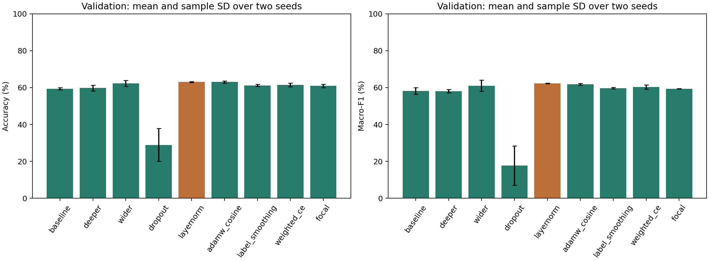
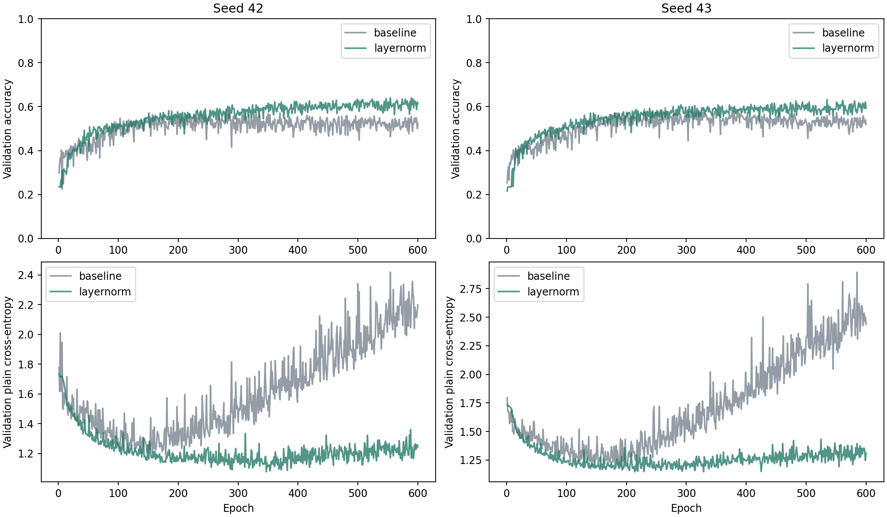
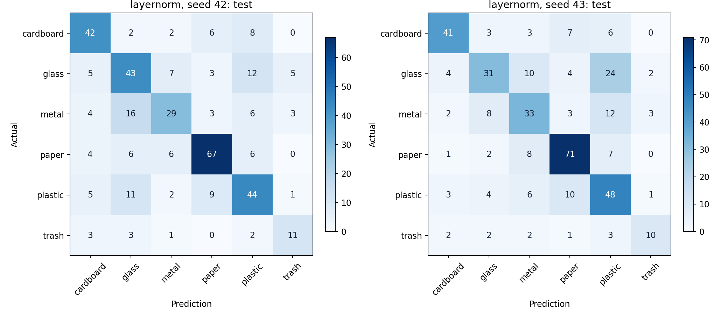

# Kết quả nâng cấp MLP Lab02 trên TrashNet

Toàn bộ mô hình khởi tạo ngẫu nhiên, không sử dụng MobileNet hay pretrained.

- Cấu hình được chọn bằng validation: **layernorm**.
- Test accuracy trung bình baseline: **55.04%**.
- Test accuracy trung bình cấu hình được chọn: **62.33%**.
- Chênh lệch accuracy: **+7.29 điểm phần trăm**.

## Validation của tất cả cấu hình

Các giá trị là trung bình ± độ lệch chuẩn mẫu trên seed 42 và 43. Accuracy được ghi tại checkpoint chọn bằng macro-F1, không lấy epoch có accuracy cao nhất riêng biệt.

| Cấu hình | Tham số | Train accuracy | Val accuracy | Val macro-F1 | Chênh val accuracy so với cha |
| --- | ---: | ---: | ---: | ---: | ---: |
| baseline | 1,577,318 | 80.50% | 59.34 ± 0.56% | 0.5820 ± 0.0186 | — |
| deeper | 1,583,526 | 89.88% | 59.74 ± 1.49% | 0.5809 ± 0.0088 | +0.39 đpt |
| wider | 3,164,710 | 92.80% | 62.24 ± 1.67% | 0.6104 ± 0.0297 | +2.50 đpt |
| dropout | 3,164,710 | 28.06% | 28.95 ± 8.93% | 0.1774 ± 0.1057 | -33.29 đpt |
| layernorm | 3,165,414 | 83.13% | 63.03 ± 0.19% | 0.6223 ± 0.0013 | +34.08 đpt |
| adamw_cosine | 3,165,414 | 83.59% | 63.03 ± 0.56% | 0.6185 ± 0.0049 | +0.00 đpt |
| label_smoothing | 3,165,414 | 83.33% | 61.18 ± 0.56% | 0.5972 ± 0.0038 | -1.84 đpt |
| weighted_ce | 3,165,414 | 83.62% | 61.45 ± 0.93% | 0.6034 ± 0.0111 | -1.58 đpt |
| focal | 3,165,414 | 80.36% | 60.92 ± 0.93% | 0.5938 ± 0.0011 | -2.11 đpt |

## Test sau khi chọn cấu hình

| Cấu hình | Seed | Epoch được chọn | Test accuracy | Test macro-F1 |
| --- | ---: | ---: | ---: | ---: |
| baseline | 42 | 280 | 57.29% | 0.5546 |
| baseline | 43 | 310 | 52.79% | 0.5214 |
| layernorm | 42 | 565 | 62.60% | 0.6108 |
| layernorm | 43 | 535 | 62.07% | 0.6066 |

Chênh lệch accuracy theo từng seed: seed 42: +5.31 đpt, seed 43: +9.28 đpt.

## Giới hạn và khả năng tái lập

- Hai seed là thí nghiệm thăm dò, chưa đủ kết luận ý nghĩa thống kê hay giới hạn tối ưu của MLP.
- Tập test đã được xem ở các thí nghiệm trước. Không phải một holdout mới chưa sử dụng.
- Cùng 600 epoch, batch 64, RGB 64×64, Xavier-normal, lật ngang p=0,5 và float32.
- So sánh chính dùng baseline chạy lại trong cùng pipeline. Không trộn với baseline lịch sử dùng cách sinh batch/augmentation khác.
- Nhánh AdamW/cosine thay cả optimizer, weight decay và lịch LR. Không tách riêng tác động của ba thành phần này.
- Manifest SHA-256: `836d92622ad570247b95fbf3f69787956a62a5479e53d0ac2e1d1886344f7d42`.
- Snapshot nguồn SHA-256: `dc8fc7160c6e733da62d5172d18a8ce7b98e7171c4f18b991f3ea7419dd6dec2`.

Xem giao thức và công thức loss trong [mlp-ablation.md](../docs/mlp-ablation.md).

## Nhận xét

- Thêm tầng làm train accuracy tăng mạnh nhưng validation macro-F1 không tăng ở thí nghiệm này. Thêm độ sâu đơn thuần chưa đủ.
- Tăng độ rộng cải thiện validation. Dropout 0,25 dùng riêng gây suy giảm rõ rệt; khi bổ sung LayerNorm, mạng học tốt trở lại.
- Ba loss mới đều có validation macro-F1 thấp hơn cấu hình cha dùng CE trong lần chạy này. Không có bằng chứng chúng cải thiện chất lượng ở các thiết lập đã thử.
- Cấu hình được chọn dùng các tầng ẩn 256→64→32, LayerNorm trước ReLU và dropout 0,25 sau ReLU, CE và Adam với LR 0,001.
- Kết quả cho thấy có thể cải thiện MLP từ Lab02, đồng thời chưa chứng minh đây là giới hạn của kiến trúc này.

## Biểu đồ

Dữ liệu kết quả: [JSON](mlp-ablation-20261111.json), [CSV](mlp-ablation-20261111.csv).
