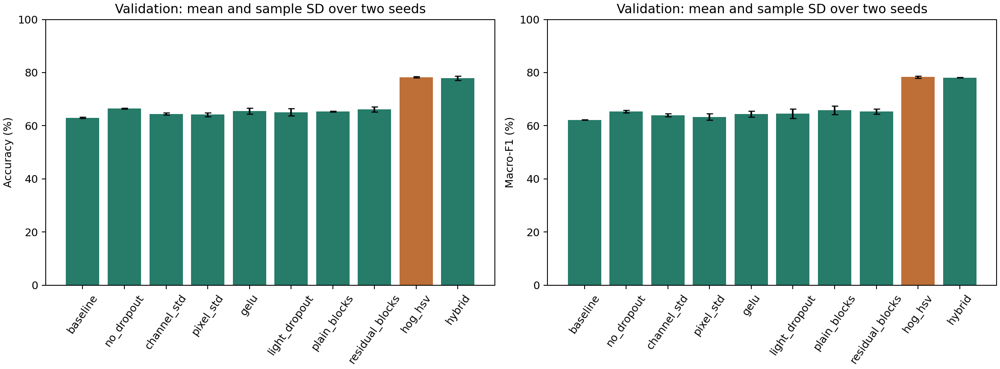
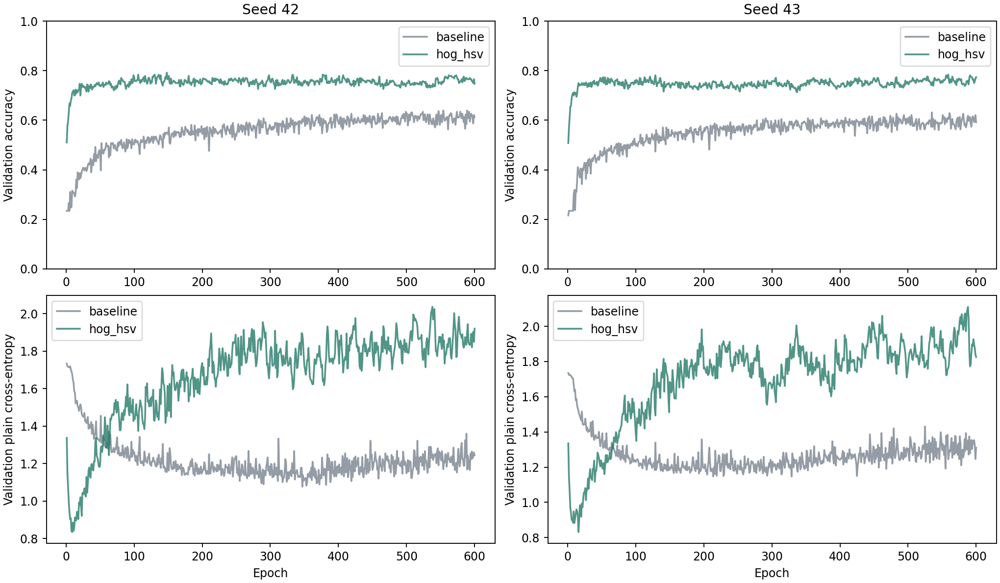
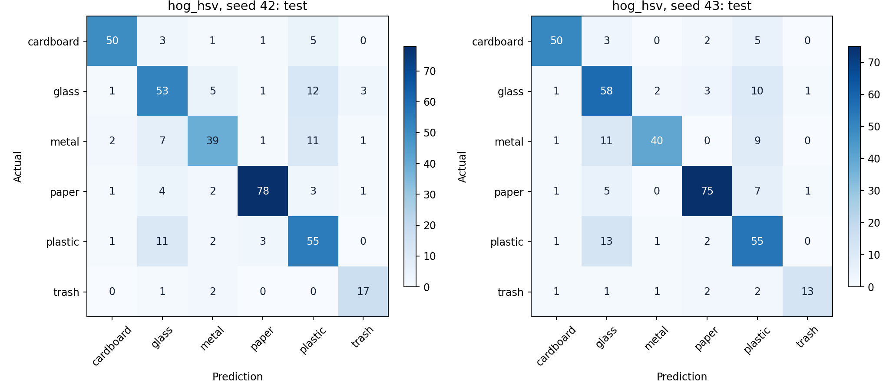

# Kết quả nâng cấp MLP Lab02 trên TrashNet — vòng hai

Toàn bộ mô hình khởi tạo ngẫu nhiên, không sử dụng MobileNet hay pretrained.

Đối chứng `baseline` của vòng hai là mô hình thắng vòng một: 256→64→32, LayerNorm, ReLU và dropout 0,25.

- Cấu hình được chọn bằng validation: **hog_hsv**.
- Test accuracy trung bình baseline: **62.33%**.
- Test accuracy trung bình cấu hình được chọn: **77.32%**.
- Chênh lệch accuracy: **+14.99 điểm phần trăm**.

## Validation của tất cả cấu hình

Các giá trị là trung bình ± độ lệch chuẩn mẫu trên seed 42 và 43. Accuracy được ghi tại checkpoint chọn bằng macro-F1, không lấy epoch có accuracy cao nhất riêng biệt.

| Cấu hình | Tham số | Train accuracy | Val accuracy | Val macro-F1 | Chênh val accuracy so với cha |
| --- | ---: | ---: | ---: | ---: | ---: |
| baseline | 3,165,414 | 83.13% | 63.03 ± 0.19% | 0.6223 ± 0.0013 | — |
| no_dropout | 3,165,414 | 93.48% | 66.45 ± 0.19% | 0.6532 ± 0.0049 | +3.42 đpt |
| channel_std | 3,165,414 | 99.63% | 64.47 ± 0.37% | 0.6395 ± 0.0057 | +1.45 đpt |
| pixel_std | 3,165,414 | 99.86% | 64.21 ± 0.74% | 0.6333 ± 0.0124 | +1.18 đpt |
| gelu | 3,165,414 | 99.80% | 65.53 ± 1.12% | 0.6439 ± 0.0107 | +1.05 đpt |
| light_dropout | 3,165,414 | 99.97% | 65.13 ± 1.30% | 0.6457 ± 0.0184 | -0.39 đpt |
| plain_blocks | 3,412,742 | 99.97% | 65.39 ± 0.19% | 0.6588 ± 0.0156 | +0.26 đpt |
| residual_blocks | 3,412,742 | 100.00% | 66.18 ± 0.93% | 0.6543 ± 0.0098 | +0.79 đpt |
| hog_hsv | 600,294 | 100.00% | 78.29 ± 0.19% | 0.7834 ± 0.0043 | +15.26 đpt |
| hybrid | 3,746,022 | 99.97% | 77.89 ± 0.74% | 0.7813 ± 0.0009 | +14.87 đpt |

## Test sau khi chọn cấu hình

| Cấu hình | Seed | Epoch được chọn | Test accuracy | Test macro-F1 |
| --- | ---: | ---: | ---: | ---: |
| baseline | 42 | 565 | 62.60% | 0.6108 |
| baseline | 43 | 535 | 62.07% | 0.6066 |
| hog_hsv | 42 | 333 | 77.45% | 0.7770 |
| hog_hsv | 43 | 556 | 77.19% | 0.7713 |

Chênh lệch accuracy theo từng seed: seed 42: +14.85 đpt, seed 43: +15.12 đpt.

## Giới hạn và khả năng tái lập

- Hai seed là thí nghiệm thăm dò, chưa đủ kết luận ý nghĩa thống kê hay giới hạn tối ưu của MLP.
- Tập test đã được xem ở các thí nghiệm trước. Không phải một holdout mới chưa sử dụng.
- Cùng 600 epoch, batch 64, RGB 64×64, Xavier-normal, lật ngang p=0,5 và float32.
- So sánh chính dùng baseline chạy lại trong cùng pipeline. Không trộn với baseline lịch sử dùng cách sinh batch/augmentation khác.
- Manifest SHA-256: `836d92622ad570247b95fbf3f69787956a62a5479e53d0ac2e1d1886344f7d42`.
- Snapshot nguồn SHA-256: `68736a9735f2f4928181ee0593686c3db33402b2146e85b93ac768d605f3ffd2`.

Xem giao thức trong [mlp-round2.md](../docs/mlp-round2.md).

## Các thay đổi được kiểm tra

Vòng hai giữ CE, Adam LR 0,001 và tập dữ liệu; thử chuẩn hóa đầu vào, bỏ/giảm dropout, GELU, block dense có/không skip và đầu vào HOG + HSV.

| Cặp đối chứng | Chênh validation accuracy | Chênh validation macro-F1 |
| --- | ---: | ---: |
| baseline → no_dropout | +3.42 đpt | +0.0309 |
| baseline → channel_std | +1.45 đpt | +0.0172 |
| baseline → pixel_std | +1.18 đpt | +0.0111 |
| channel_std → gelu | +1.05 đpt | +0.0044 |
| gelu → light_dropout | -0.39 đpt | +0.0017 |
| light_dropout → plain_blocks | +0.26 đpt | +0.0131 |
| plain_blocks → residual_blocks | +0.79 đpt | -0.0045 |
| baseline → hog_hsv | +15.26 đpt | +0.1611 |
| baseline → hybrid | +14.87 đpt | +0.1591 |

Cấu hình được chọn có các tầng ẩn `[256, 64, 32]`, dùng biểu diễn `hog_hsv`, chuẩn hóa `feature`, activation `relu`, dropout 0.25 và block_depth=0, residual=False.

HOG/HSV là đặc trưng OpenCV cố định đưa vào MLP, không phải backbone pretrained. Các nhánh descriptor thay đổi cả biểu diễn và số đầu vào nên cần đọc cùng số tham số. Cặp plain/residual giữ nguyên số tham số và khởi tạo, chỉ thay phép cộng skip.

## Nhận xét từ kết quả vòng hai

- Chỉ bỏ dropout trong MLP pixel đã tăng validation accuracy từ 63,03% lên 66,45%. Điều này cho thấy dropout 0,25 chưa phải lựa chọn tốt nhất khi đã có LayerNorm.
- Chuẩn hóa đầu vào và GELU mang lại mức cải thiện nhỏ hơn nhánh descriptor. Không phải mọi thay đổi được kết hợp đều tốt hơn cấu hình đơn giản.
- Skip connection tăng validation accuracy khoảng 0,79 điểm phần trăm so với mạng plain có cùng tham số, nhưng validation macro-F1 giảm khoảng 0,0045. Chưa có bằng chứng nó tốt hơn theo tiêu chí chọn mô hình.
- HOG + HSV đạt validation accuracy 78,29% và test accuracy 77,32%. Nhánh hybrid đạt validation 77,89%, chưa vượt HOG + HSV theo quy tắc chọn đã đặt.
- Nhánh HOG + HSV vẫn giữ MLP 256→64→32→6, LayerNorm, ReLU, dropout 0,25, CE và Adam. Thay đổi chính là thay vector pixel 12288 chiều bằng descriptor 2268 chiều được chuẩn hóa theo train, giảm số tham số xuống 600294.
- Đây là cải tiến cả biểu diễn lẫn số đầu vào và chuẩn hóa, không thể quy toàn bộ mức tăng cho riêng HOG hay riêng HSV. Cần ablation HOG-only/HSV-only nếu muốn tách hai đóng góp đó.
- Train accuracy của nhánh thắng đạt 100%, trong khi validation/test khoảng 77–78%. Overfitting vẫn còn; kết quả chưa chứng minh khả năng tổng quát sang ảnh rác ngoài TrashNet.

## Biểu đồ

Dữ liệu kết quả: [JSON](mlp-round2-20261111.json), [CSV](mlp-round2-20261111.csv).
