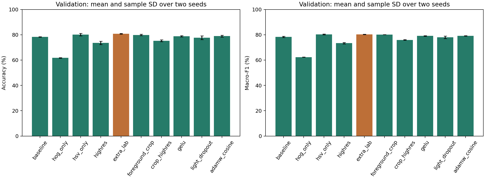
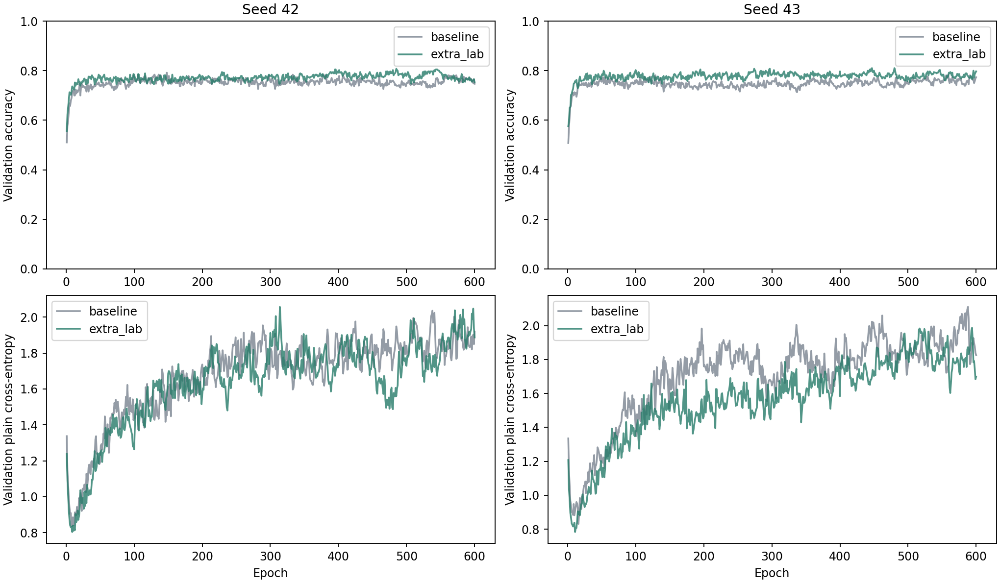
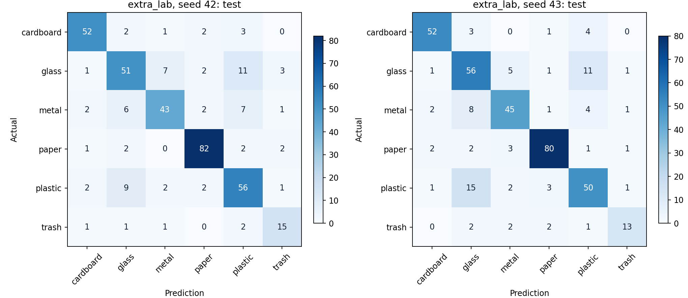

# Kết quả nâng cấp MLP Lab02 trên TrashNet — vòng ba

Toàn bộ mô hình khởi tạo ngẫu nhiên, không sử dụng MobileNet hay pretrained.

Đối chứng `baseline` của vòng ba là HOG + HSV → MLP thắng vòng hai, với 2268 đầu vào và 600294 tham số.

- Cấu hình được chọn bằng validation: **extra_lab**.
- Test accuracy trung bình baseline: **77.32%**.
- Test accuracy trung bình cấu hình được chọn: **78.91%**.
- Chênh lệch accuracy: **+1.59 điểm phần trăm**.

## Validation của tất cả cấu hình

Các giá trị là trung bình ± độ lệch chuẩn mẫu trên seed 42 và 43. Accuracy được ghi tại checkpoint chọn bằng macro-F1, không lấy epoch có accuracy cao nhất riêng biệt.

| Cấu hình | Tham số | Train accuracy | Val accuracy | Val macro-F1 | Chênh val accuracy so với cha |
| --- | ---: | ---: | ---: | ---: | ---: |
| baseline | 600,294 | 100.00% | 78.29 ± 0.19% | 0.7834 ± 0.0043 | — |
| hog_only | 471,270 | 100.00% | 61.71 ± 0.19% | 0.6230 ± 0.0006 | -16.58 đpt |
| hsv_only | 148,710 | 100.00% | 80.13 ± 0.93% | 0.8026 ± 0.0038 | +1.84 đpt |
| highres | 2,222,310 | 99.94% | 73.55 ± 1.30% | 0.7334 ± 0.0062 | -4.74 đpt |
| extra_lab | 729,318 | 100.00% | 80.79 ± 0.37% | 0.8028 ± 0.0018 | +2.50 đpt |
| foreground_crop | 600,294 | 100.00% | 79.87 ± 0.56% | 0.8016 ± 0.0002 | +1.58 đpt |
| crop_highres | 2,222,310 | 100.00% | 75.26 ± 0.74% | 0.7594 ± 0.0021 | +1.71 đpt |
| gelu | 600,294 | 100.00% | 78.82 ± 0.56% | 0.7910 ± 0.0024 | +0.53 đpt |
| light_dropout | 600,294 | 99.89% | 77.63 ± 1.49% | 0.7804 ± 0.0096 | -0.66 đpt |
| adamw_cosine | 600,294 | 99.94% | 78.95 ± 0.74% | 0.7912 ± 0.0019 | +0.66 đpt |

## Test sau khi chọn cấu hình

| Cấu hình | Seed | Epoch được chọn | Test accuracy | Test macro-F1 |
| --- | ---: | ---: | ---: | ---: |
| baseline | 42 | 333 | 77.45% | 0.7770 |
| baseline | 43 | 556 | 77.19% | 0.7713 |
| extra_lab | 42 | 543 | 79.31% | 0.7805 |
| extra_lab | 43 | 447 | 78.51% | 0.7743 |

Chênh lệch accuracy theo từng seed: seed 42: +1.86 đpt, seed 43: +1.33 đpt.

## Giới hạn và khả năng tái lập

- Hai seed là thí nghiệm thăm dò, chưa đủ kết luận ý nghĩa thống kê hay giới hạn tối ưu của MLP.
- Tập test đã được xem ở các thí nghiệm trước. Không phải một holdout mới chưa sử dụng.
- Cùng 600 epoch, batch 64, Xavier-normal, lật ngang p=0,5 và float32. Vòng ba so sánh descriptor ở 64×64 và 128×128, lấy trực tiếp từ ảnh gốc.
- So sánh chính dùng baseline chạy lại trong cùng pipeline. Không trộn với baseline lịch sử dùng cách sinh batch/augmentation khác.
- Nhánh AdamW/cosine thay cả optimizer, weight decay và lịch LR. Không tách riêng tác động của ba thành phần này.
- Manifest SHA-256: `836d92622ad570247b95fbf3f69787956a62a5479e53d0ac2e1d1886344f7d42`.
- Snapshot nguồn SHA-256: `d4f45356c1681a3e9132bd18f4d2df2a373c4bebb1c2c2509412a1e022bb011c`.

Xem giao thức trong [mlp-round3.md](../docs/mlp-round3.md).

## Các thay đổi được kiểm tra

Vòng ba phân tích HOG-only/HSV-only, độ phân giải descriptor, thêm Lab, cắt nền cố định và thay đổi activation/dropout/optimizer của MLP.

| Cặp đối chứng | Chênh validation accuracy | Chênh validation macro-F1 |
| --- | ---: | ---: |
| baseline → hog_only | -16.58 đpt | -0.1603 |
| baseline → hsv_only | +1.84 đpt | +0.0192 |
| baseline → highres | -4.74 đpt | -0.0500 |
| baseline → extra_lab | +2.50 đpt | +0.0195 |
| baseline → foreground_crop | +1.58 đpt | +0.0182 |
| highres → crop_highres | +1.71 đpt | +0.0260 |
| baseline → gelu | +0.53 đpt | +0.0076 |
| baseline → light_dropout | -0.66 đpt | -0.0030 |
| baseline → adamw_cosine | +0.66 đpt | +0.0079 |

Cấu hình được chọn có các tầng ẩn `[256, 64, 32]`, dùng biểu diễn `hog_hsv_lab`, chuẩn hóa `feature`, activation `relu`, dropout 0.25 và block_depth=0, residual=False.

HOG/HSV là đặc trưng OpenCV cố định đưa vào MLP, không phải backbone pretrained. Các nhánh descriptor thay đổi cả biểu diễn và số đầu vào nên cần đọc cùng số tham số. Các thống kê chuẩn hóa chỉ dùng train. Độ phân giải lớn hơn lấy trực tiếp từ ảnh gốc. Cắt nền là phép xử lý cố định, không dùng nhãn và có thể làm mất chi tiết ở vật thể nhạt màu.

## F1 test theo lớp

Các giá trị dưới đây là trung bình F1 của hai seed, không phải F1 của một ensemble.

| Lớp | Baseline | Cấu hình được chọn | Chênh lệch |
| --- | ---: | ---: | ---: |
| cardboard | 0.8696 | 0.8777 | +0.0081 |
| glass | 0.6936 | 0.6971 | +0.0036 |
| metal | 0.7292 | 0.7553 | +0.0261 |
| paper | 0.8844 | 0.9101 | +0.0257 |
| plastic | 0.6919 | 0.7157 | +0.0238 |
| trash | 0.7762 | 0.7085 | -0.0677 |

## Nhận xét từ kết quả vòng ba

- Accuracy test tăng ở cả hai seed, thêm 7 và 5 ảnh đúng trên cùng 377 ảnh test. Mức tăng trung bình 1,59 điểm phần trăm nhỏ hơn bước tăng ở vòng hai.
- F1 của 5 lớp tăng, nhưng lớp trash giảm trung bình từ 0,7762 xuống 0,7085. Vì vậy macro-F1 toàn bộ chỉ tăng từ 0,7741 lên 0,7774, chưa phải cải thiện đồng đều giữa các lớp.
- Validation macro-F1 của extra_lab (0,802822) và HSV-only (0,802596) gần như ngang nhau, chênh khoảng 0,00023. Quy tắc đặt trước chọn extra_lab, nhưng hai seed chưa đủ để khẳng định nó vượt HSV-only một cách ổn định.
- HSV-only đạt validation accuracy 80,13% với 148710 tham số, so với 80,79% và 729318 tham số của extra_lab. Không đánh giá test HSV-only trong vòng này vì nó không thắng theo tiêu chí chọn đã đặt.
- HOG-only thấp hơn rõ trong thí nghiệm này; tăng descriptor lên 128×128 cũng không giúp. Các kết quả này chỉ áp dụng cho dataset, MLP và thiết lập đã thử, không chứng minh HOG nói chung không hữu ích.
- Cấu hình thắng vẫn dùng MLP 256→64→32→6, LayerNorm, ReLU, dropout 0,25, CE và Adam. Bổ sung histogram Lab làm số đầu vào tăng 2268→2772 và tham số tăng 600294→729318.
- Train accuracy vẫn đạt 100%, nên overfitting còn tồn tại. Tập test đã được dùng ở các vòng trước; cần thêm seed hoặc dữ liệu độc lập nếu muốn kết luận chắc hơn về khả năng tổng quát.

## Biểu đồ

Dữ liệu kết quả: [JSON](mlp-round3-20261111.json), [CSV](mlp-round3-20261111.csv).
